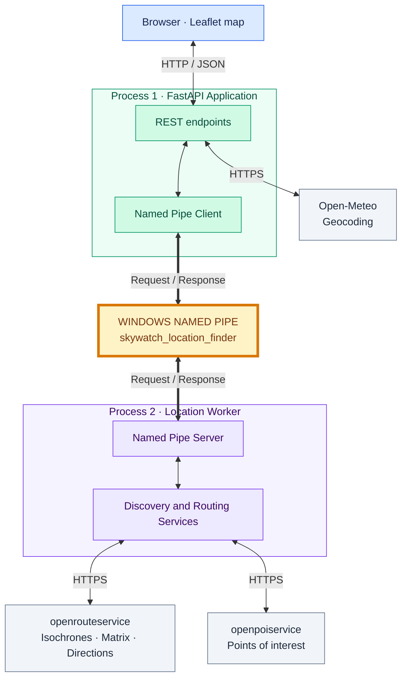

# SkyWatch – Location Finder

Location Finder discovers reachable outdoor locations for potential astronomical observation. It combines geocoding, points of interest and route planning with an interactive map.

The main focus of this module is **interprocess communication (IPC) using Windows Named Pipes** between a FastAPI application and an independent Location Worker.

## Setup and Running

Requirements: Windows, Python 3.12 and an openrouteservice API key with access to the routing and POI services.

From the `location-finder/` directory:

```powershell
python -m venv .venv
.\.venv\Scripts\Activate.ps1
pip install -r backend/requirements.txt
Copy-Item .env.example .env
```

Set `ORS_API_KEY` in `.env`. The remaining settings have defaults in `.env.example`. Do not commit `.env`.

**Terminal 1 – Location Worker** (from `location-finder/`):

```powershell
.\.venv\Scripts\Activate.ps1
cd backend
python -m worker.main
```

**Terminal 2 – FastAPI application** (from `location-finder/`):

```powershell
.\.venv\Scripts\Activate.ps1
cd backend
python -m app.main
```

Open [http://127.0.0.1:8003](http://127.0.0.1:8003) in a browser. Interactive API documentation is available at [/docs](http://127.0.0.1:8003/docs).

## Architecture



The FastAPI process handles HTTP requests and geocoding. The independent worker handles location discovery and routing. All worker operations are exchanged through the named pipe; no HTTP server is required in the worker.

## Named Pipes and Communication Protocol

The application uses a local, duplex Windows named pipe (`\\.\pipe\skywatch_location_finder`) implemented with `pywin32` and overlapped I/O.

- UTF-8 JSON messages with a 4-byte, big-endian length header.
- Pydantic validation, protocol version and matching request IDs.
- Supported operations: `ping`, `find_locations`, `get_route`.
- Connection retries, response deadlines and structured error responses.
- Client acknowledgement after receiving a complete response.
- Cancellation of pending I/O and cleanup of Windows handles on failure.
- Blocking pipe operations run in a background thread to keep the FastAPI event loop responsive.

## Location Discovery

1. Select an origin, transport mode and travel time or distance limit.
2. Calculate a reachable area (isochrone) with openrouteservice.
3. Search for POIs within the area using openpoiservice, splitting large areas when necessary.
4. Deduplicate candidates and filter by geometry and network travel range.
5. Sort by travel time or distance and display results on the map.
6. Request a navigation route to a selected candidate.

Supported POI categories: viewpoints, peaks, saddles, parks and campsites. Transport modes: driving, cycling and walking.

## Project Structure

```text
location-finder/
├── .env.example
├── .gitignore
├── README.md
│
├── backend/
│   ├── requirements.txt
│   │
│   ├── app/                         # FastAPI process
│   │   ├── api/
│   │   │   ├── health.py
│   │   │   ├── locations.py
│   │   │   ├── discovery.py
│   │   │   └── routes.py
│   │   ├── clients/
│   │   │   └── geocoding.py
│   │   ├── pipes/
│   │   │   └── client.py            # Named Pipe client
│   │   ├── config.py
│   │   └── main.py
│   │
│   ├── worker/                      # Independent worker process
│   │   ├── clients/
│   │   │   ├── openrouteservice.py
│   │   │   └── openpoiservice.py
│   │   ├── pipes/
│   │   │   └── server.py            # Named Pipe server
│   │   ├── services/
│   │   │   ├── candidates.py        # POI processing and filtering
│   │   │   ├── discovery.py         # Location discovery workflow
│   │   │   ├── geometry.py
│   │   │   └── routing.py
│   │   ├── config.py
│   │   └── main.py
│   │
│   ├── shared/                      # Shared by both processes
│   │   ├── models/
│   │   │   ├── location.py
│   │   │   ├── messages.py          # Named Pipe message models
│   │   │   ├── requests.py
│   │   │   └── responses.py
│   │   ├── config.py
│   │   ├── constants.py
│   │   ├── errors.py
│   │   └── protocol.py             # Message framing and serialization
│   │
│   └── tests/
│
└── frontend/
    ├── css/
    ├── js/
    │   ├── api.js
    │   ├── app.js                   # Application state and coordination
    │   ├── map.js
    │   └── ui.js
    └── index.html
```

## REST API

- `GET /api/health` – API and worker availability.
- `GET /api/locations?name=Maribor` – geocoding search.
- `POST /api/discover` – reachable candidate locations.
- `POST /api/route` – navigation route to a selected destination.

## Testing

**53 tests passed** across the protocol, geometry, candidate processing, Named Pipes and REST API test suites.

From `location-finder/backend/`, with the API and worker stopped:

```powershell
python -m pytest tests/test_protocol.py tests/test_geometry.py tests/test_candidates.py tests/test_pipes.py -v
```

For REST API integration tests, start both processes first:

```powershell
python -m pytest tests/test_api.py -v -k "not worker_unavailable"
```

Then stop only the worker and run:

```powershell
python -m pytest tests/test_api.py -v -k "worker_unavailable"
```

Named Pipe tests cover normal communication, repeated requests, delayed worker startup, connection and active I/O timeouts, and recovery after timeouts or worker restarts.

## Technologies

Python, FastAPI, Pydantic, httpx, pywin32, Shapely, PyProj, pytest, HTML, CSS, JavaScript and Leaflet.

