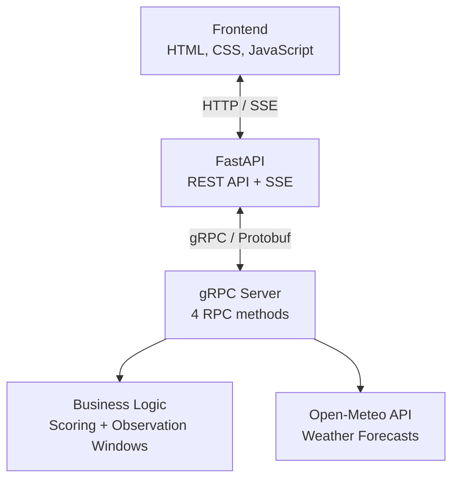

# SkyWatch – Observation Conditions

Observation Conditions is a standalone module of the **SkyWatch** project. It uses gRPC and Open-Meteo to retrieve weather forecasts, evaluate astronomical observation conditions, identify suitable observation windows, and compare locations.

## Features

- **Location Search:** Search for locations by name or enter coordinates manually.
- **Weather Forecasts:** View hourly cloud cover, precipitation, and wind conditions.
- **Conditions Assessment:** Calculate weather suitability scores (0–100) with explanations.
- **Observation Windows:** Find favorable observation periods or the best available alternative.
- **Location Comparison:** Compare multiple locations using server-side gRPC streaming.
- **Date Selection:** Plan observations for today and the next 14 days.

## Technologies

- **Backend:** Python, FastAPI, Pydantic
- **gRPC:** grpcio, Protocol Buffers
- **Frontend:** HTML, CSS, JavaScript
- **External APIs:** Open-Meteo Weather and Geocoding
- **Streaming:** gRPC server-side streaming, SSE
- **Testing:** pytest

## gRPC Integration

The `ObservationConditionsService` defines four RPC methods:

- **GetWeatherForecast (Unary):** Retrieves hourly weather forecasts.
- **EvaluateConditions (Unary):** Evaluates conditions for a selected hour.
- **FindBestObservationWindows (Unary):** Finds favorable observation intervals.
- **StreamLocationComparison (Server streaming):** Streams comparison results for multiple locations.

The service is defined in `proto/observation_conditions.proto`. Python gRPC classes are generated using Protocol Buffers.

FastAPI connects the browser to the gRPC server and forwards streaming results through SSE.

## Conditions Assessment

Observation suitability is calculated using cloud cover (60%), precipitation probability (25%), and wind speed (15%). Forecast precipitation reduces the score further.

Hours scoring at least 60/100 are considered favorable. Otherwise, the best available hour is displayed without a recommendation.

The assessment considers weather conditions only, not light pollution, astronomical visibility, or site accessibility.

## Architecture



## Project Structure

```text
observation-conditions/
├── proto/                  # gRPC service definition
├── backend/
│   ├── app/
│   │   ├── api/           
│   │   ├── clients/        # Open-Meteo clients
│   │   ├── grpc/           # gRPC server and client
│   │   ├── models/         # Weather models
│   │   ├── services/       # Conditions and observation windows
│   │   ├── config.py
│   │   └── main.py
│   ├── proto/              # Generated Protobuf classes
│   ├── tests/
│   └── requirements.txt
├── frontend/
│   ├── css/
│   ├── js/
│   └── index.html
├── .gitignore
└── README.md
```

## Setup and Usage

**1. Create and activate a virtual environment**

From `observation-conditions/`:

```powershell
py -m venv .venv
.\.venv\Scripts\Activate.ps1
```

**2. Install dependencies**

```powershell
python -m pip install -r backend/requirements.txt
```

**3. Start the gRPC server**

From `observation-conditions/backend/`:

```powershell
python -m app.grpc.server
```

**4. Start FastAPI**

In a second terminal, from `backend/` with the virtual environment activated:

```powershell
python -m uvicorn app.main:app --reload --port 8001
```

Open **http://127.0.0.1:8001/** in your browser.

API documentation: **http://127.0.0.1:8001/docs**

## Testing

Run unit tests from `backend/`:

```powershell
python -m pytest tests/test_conditions.py tests/test_observation_windows.py -v
```

To demonstrate all four RPC methods, start the gRPC server and run:

```powershell
python -m tests.test_grpc
```

## External Services

- [Open-Meteo Weather API](https://open-meteo.com/en/docs) – hourly forecasts.
- [Open-Meteo Geocoding API](https://open-meteo.com/en/docs/geocoding-api) – location search.